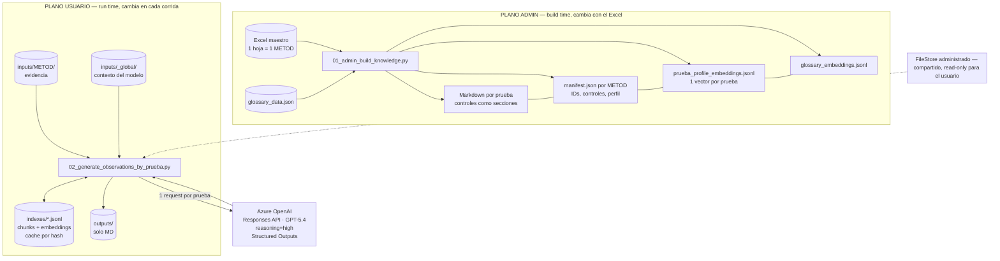
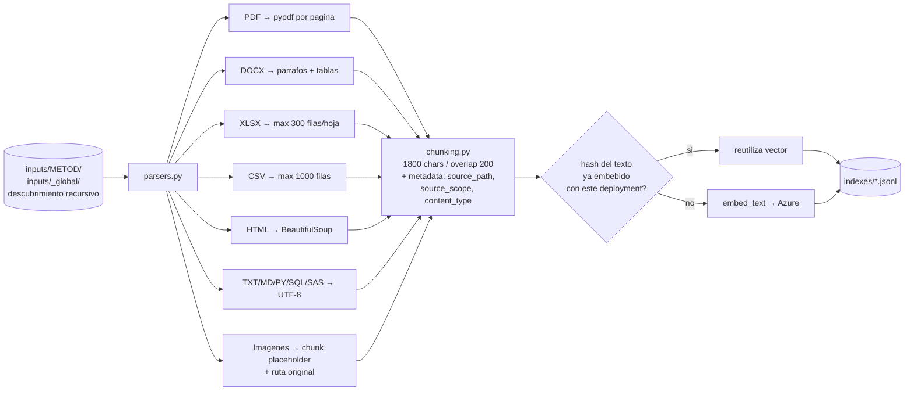
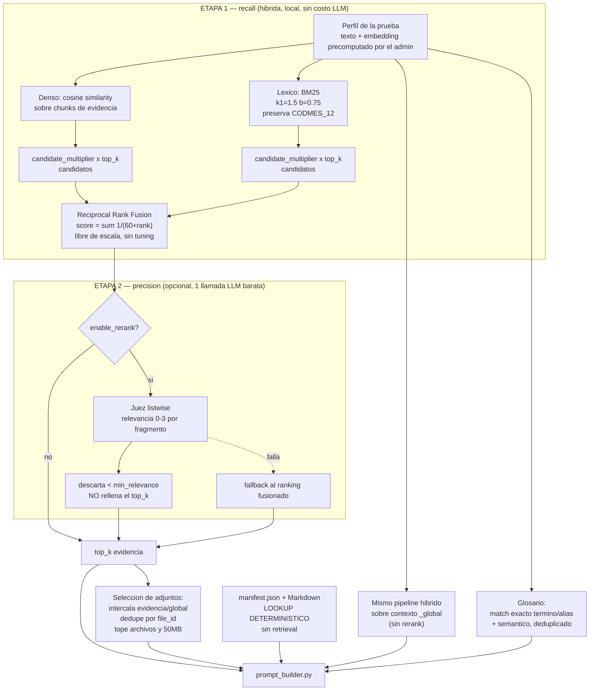
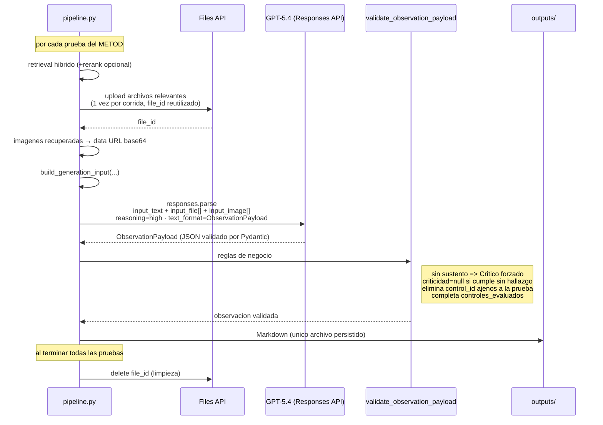

# Arquitectura y justificacion tecnica

> Documento de defensa tecnica y explicacion end-to-end del Gestor de Observaciones.
> Audiencia: AI engineers, arquitectos y revisores tecnicos.
> Fuente de verdad: el codigo en `metod_observations/`.

---

## Parte 1 — Por que RAG

### 1.1 El problema real

El sistema debe generar una **observacion metodologica por prueba**, donde cada prueba agrupa varios controles. Para cada prueba hay que decidir:

- si hay o no hallazgo (`hay_observacion`);
- con que criticidad (`Critico`, `Relevante`, `Moderado`, `Baja`, `Potencial`);
- **citando explicitamente que fragmento de que archivo lo sustenta** (`evidencias_usadas` con `chunk_id` y `score`).

La entrada del usuario no es una pregunta: es un corpus arbitrario de evidencia que el usuario sube (`.pdf`, `.xlsx`, `.docx`, `.csv`, `.sas`, `.sql`, `.py`, `.html`, imagenes) mas contexto global compartido del modelo.

Ese enunciado ya define el espacio de soluciones. RAG no es una preferencia estetica: es la unica de las opciones disponibles que satisface las tres restricciones a la vez (costo acotado, trazabilidad verificable, conocimiento que cambia en cada ejecucion).

### 1.2 Las cinco defensas

#### Defensa 1 — El conocimiento cambia en cada ejecucion; no se puede entrenar

La evidencia es **distinta para cada usuario y para cada corrida**. No existe un corpus estable que se pueda destilar en pesos.

- **Fine-tuning** ensena estilo y formato, no hechos nuevos, y no puede citar la fuente. Reentrenar cada vez que un usuario sube un `.xlsx` es economicamente absurdo y operativamente imposible.
- **Prompt estatico con todo el conocimiento** falla por la misma razon: el conocimiento aun no existe cuando se escribe el prompt.

Solo queda inyeccion de contexto en tiempo de ejecucion. Eso *es* RAG.

#### Defensa 2 — El costo escala con el numero de pruebas, no con el de documentos

Este es el argumento cuantitativo y el mas dificil de refutar.

El diseno hace **una llamada LLM por prueba** (decision deliberada: los controles de una prueba se evaluan en conjunto porque comparten evidencia). Si `P` = numero de pruebas de un METOD y `T` = tokens del corpus completo de evidencia:

| Estrategia | Tokens de entrada facturados |
|---|---|
| Meter todo el corpus en cada llamada | `P × T` |
| RAG (top-k por prueba) | `P × k×chunk_size` + `T` embebido **una sola vez** |

Con `SOFTIA_CHUNK_SIZE=1800` y `SOFTIA_TOP_K_EVIDENCE=8`, el contexto recuperado por prueba queda acotado a ~14K caracteres **independientemente de si el usuario subio 5 archivos o 500**. El corpus completo se embebe una vez, se cachea por hash (`embed_rows_with_cache`) y se reutiliza mientras el archivo no cambie.

El punto clave: **el costo de RAG es sublineal respecto al tamano del corpus; el de stuffing es lineal y ademas multiplicado por P.** Con `reasoning={"effort": "high"}`, cada token de entrada compite ademas con el presupuesto de razonamiento dentro de `max_output_tokens=25000`.

A esto se suman limites duros no negociables: el request tiene tope de 50 MB combinados, y los rate limits de Azure OpenAI son por tokens por minuto.

#### Defensa 3 — La trazabilidad es requisito regulatorio, no una feature

Esto es validacion metodologica de modelos. Una observacion de criticidad `Critico` tiene consecuencias. El revisor humano debe poder responder: **"por que el sistema dijo esto?"**

RAG produce ese rastro de auditoria como subproducto natural de la arquitectura:

- `evidencias_usadas` en la salida estructurada obliga al modelo a citar `archivo`, `chunk_id` y `score`;
- `result["retrieval_debug"]` registra, por prueba, **todo** lo que se recupero: score, modo de retrieval, que canal lo encontro (`found_by`), relevancia del rerank, si se adjunto como archivo o imagen. Por decision del usuario ya no se persiste en disco: vive solo en el objeto que devuelve la corrida, asi que se inspecciona en el notebook o se pierde al terminar la sesion.

Con contexto largo indiferenciado no existe forma de reconstruir que pasaje sustento un hallazgo. El modelo dice "segun la evidencia" y no hay nada que auditar. **La observabilidad del retrieval es lo que hace este sistema defendible ante un auditor**, y por eso el modulo se llama `retrieval_debug` y no es opcional.

Corolario operativo: cuando la salida es mala, el debug permite distinguir un fallo de *retrieval* (nunca se recupero el chunk correcto) de un fallo de *generacion* (estaba ahi y el modelo lo ignoro). Sin esa separacion no hay ciclo de mejora posible.

#### Defensa 4 — Mas contexto empeora la precision en tareas de deteccion

Contraintuitivo pero central. La tarea no es "resumir el corpus", es **decidir si un control especifico se incumple**. Es una tarea de deteccion, y en deteccion el ruido produce falsos positivos.

Un chunk irrelevante que menciona superficialmente el tema de la prueba puede inducir al modelo a fabricar un hallazgo. Por eso el sistema es explicitamente conservador:

- si no hay sustento suficiente (`sustento_suficiente=false`), la prueba se reporta como `Critico`: falta de evidencia equivale a incumplimiento, no a ausencia de hallazgo;
- `hay_observacion=false` con `criticidad=null` solo aplica cuando hay evidencia suficiente y la prueba se cumple;
- el reranker descarta todo lo que este por debajo de `rerank_min_relevance` **en lugar de rellenar el top-k**, precisamente para que un chunk irrelevante no llegue al generador solo por completar cupo (ver `reranking.py:60-63`).

Un falso positivo en este dominio cuesta horas de revision humana y erosiona la confianza en el sistema. Filtrar es mas valioso que incluir.

#### Defensa 5 — Solo se aplica RAG donde hay incertidumbre real

Esta es la defensa que desactiva la critica mas comun ("estas usando RAG como martillo universal"). **El sistema es hibrido y la frontera esta trazada a proposito:**

| Informacion | Mecanismo | Por que |
|---|---|---|
| Detalle del control, prompt, limites, criticidad, excepciones, lista de controles esperados | **Lookup deterministico** desde `manifest.json` y el Markdown de la prueba | El sistema ya sabe exactamente que prueba evalua. Recuperar semanticamente una regla que se conoce por ID seria introducir un error probabilistico donde hay certeza. |
| Que fragmentos de la evidencia del usuario aplican a esta prueba | **RAG** | Genuinamente desconocido en tiempo de ejecucion. |
| Que contexto global del modelo aplica a esta prueba | **RAG** | Idem. |
| Que terminos del glosario son relevantes | **Hibrido**: match exacto de termino/alias + similitud semantica | El match exacto es determinista cuando el termino aparece literal; lo semantico cubre el resto. |

Las reglas de negocio **nunca** pasan por un retriever. Se leen por ID. RAG se reserva para el unico punto donde hay incertidumbre real: el mapeo evidencia → prueba.

---

### 1.3 Respuestas a las objeciones esperables

**"Los modelos de contexto largo hacen obsoleto a RAG."**

Tres respuestas, en orden de fuerza:

1. Contexto largo no resuelve el costo `P × T` ni el limite de 50 MB por request. El problema economico persiste intacto.
2. Contexto largo no produce atribucion. Sigue sin haber `chunk_id` que citar ni forma de auditar.
3. **El sistema ya usa contexto largo — RAG es lo que decide cuando usarlo.** Cuando un chunk es recuperado, el archivo *completo* se adjunta via Files API como `input_file` (hasta `SOFTIA_MAX_PROMPT_FILES`), y los PDFs con `detail="high"`. Es decir: el retrieval actua como **router** que selecciona que documentos merecen contexto largo, y el modelo los lee enteros. No es RAG *en lugar de* contexto largo; es RAG *dirigiendo* contexto largo. Esa combinacion es estrictamente superior a cualquiera de las dos por separado.

**"Por que no una base vectorial (Pinecone, Chroma, Databricks Vector Search)?"**

El corpus por METOD es la evidencia de *un* usuario: cientos de chunks, no millones. La busqueda exacta en Python sobre JSONL toma milisegundos y la latencia real esta dominada por la llamada al LLM con `reasoning=high`, no por el retrieval. Una vector DB anadiria un servicio que operar, versionar y sincronizar, con indices ANN aproximados, a cambio de cero ganancia perceptible. Es complejidad sin retorno para el volumen actual.

El umbral esta identificado: si el corpus por usuario crece varios ordenes de magnitud o el retrieval aparece en el perfil de latencia, se migra. Hoy no es el caso.

**"Por que no un agente con herramientas que busque iterativamente?"**

Se necesita salida determinista y validable (`ObservationPayload` de Pydantic, criticidad restringida a un enum, IDs de control cruzados contra la prueba). Un bucle agentico introduce numero de llamadas no acotado, latencia variable y costo no predecible, para una tarea cuyo patron de acceso a datos se conoce de antemano: una prueba, su evidencia relevante, un veredicto. La estructura del problema no requiere exploracion.

**"Por que no LangChain / LlamaIndex?"**

El pipeline completo cabe en modulos de funciones puras y se ejecuta dentro de un notebook Databricks. Los frameworks aportan abstraccion sobre variabilidad de providers y flujos que aqui no existe (un solo provider, un solo flujo). El costo seria opacidad en el punto exacto donde mas se necesita visibilidad: el ranking. Con `retrieval.py` propio, cada score es inspeccionable.

---

### 1.4 El retrieval no es cosine similarity ingenuo

Si la defensa se detiene en "usamos RAG", un revisor competente atacara la calidad del retrieval. La respuesta esta en el codigo:

**Retrieval hibrido con fusion por rango reciproco** (`retrieval.py`):

- **Canal denso**: cosine similarity sobre `text-embedding-3-small`.
- **Canal lexico**: BM25 implementado localmente. Es indispensable en este dominio porque la evidencia esta llena de **identificadores exactos** — `CODMES`, `target_default`, nombres de variables, tablas y campos. Los embeddings densos son notoriamente debiles en matching exacto de tokens raros; BM25 los captura con precision. Por eso el tokenizador preserva `_` como parte del token: `CODMES_12` debe ser una unidad lexica, no dos.
- **Fusion RRF** (`k=60`): cosine y BM25 viven en escalas incomparables. Cualquier suma ponderada de sus scores exige calibracion por corpus, que se desajusta cuando cambia la evidencia. La posicion en el ranking es libre de escala, y eso hace la fusion estable **sin hiperparametros que tunear**.
- Cada canal propone `candidate_multiplier × top_k` candidatos, para que la fusion pueda promover un chunk que solo un canal encontro.

**Reranking listwise opcional** (`reranking.py`, `SOFTIA_ENABLE_RERANK`):

La primera etapa optimiza *recall* sobre una ventana amplia de candidatos; el reranker cambia una llamada barata por *precision*, puntuando 0–3 cada fragmento y descartando lo que no llegue al umbral. Degrada con elegancia: **cualquier fallo vuelve al ranking fusionado en vez de romper la corrida** — el rerank es una mejora, no una dependencia.

**Consulta precomputada por el admin**: el embedding de consulta de cada prueba se genera una sola vez (a partir del nombre de la prueba y sus controles) y se reutiliza en todas las corridas de todos los usuarios. Cero llamadas de embedding de consulta en runtime.

---

### 1.5 Limitaciones reconocidas

Declararlas fortalece la defensa; ocultarlas la destruye si el revisor las encuentra.

- **Sin OCR**: un PDF escaneado no produce texto util. Pendiente identificado.
- **Recuperacion de imagenes por nombre de archivo**: hoy una imagen se indexa con un texto generico derivado de su nombre. La lectura visual real ocurre despues, cuando la imagen recuperada se adjunta en base64. Mejora prevista: captions generados o indice multimodal.
- **Sin umbral minimo de score**: siempre se toman los mejores `top_k` aunque todos tengan baja similitud. Mitigado por prompt (instruye no usar lo que no sustente) y por el reranker cuando esta activo, pero aun no hay corte duro por score.
- **`evidencias_usadas` no se cruza programaticamente** contra el conjunto realmente enviado al modelo. El schema valida la forma, no la procedencia.

---

## Parte 2 — Arquitectura end-to-end

### 2.1 Vista general

Dos planos separados por responsabilidad y por frecuencia de cambio: el **admin** construye conocimiento estable (cambia cuando cambia el Excel); el **usuario** ejecuta contra su propia evidencia (cambia en cada corrida).

**Por que la separacion importa**: el embedding de perfil de cada prueba se calcula una vez, en el plano admin, y sirve como consulta para todos los usuarios en todas las corridas. El plano usuario nunca genera embeddings de consulta. El runtime valida ademas que el deployment de embeddings que genero los indices admin coincida con el actual, y falla ruidosamente si no (`_read_admin_index`).

---

### 2.2 Ingesta de evidencia del usuario

El cache compara `id` + hash del texto + nombre del deployment. Cambiar el deployment de embeddings invalida el cache correctamente en lugar de mezclar espacios vectoriales incompatibles.

Nota de diseno: el chunk de una imagen es un placeholder textual, pero conserva `source_path`. Eso permite que, si es recuperado, la imagen **real** se adjunte en base64 al request multimodal. El indice es textual; la lectura es visual.

---

### 2.3 El nucleo: retrieval por prueba

Este es el diagrama que un AI engineer va a querer ver.

Cuatro decisiones defendibles concentradas aqui:

1. **La consulta no es la pregunta del usuario** — no hay usuario preguntando. La consulta es el *perfil de la prueba*: su nombre mas sus controles. Es una consulta estable, curada por el admin y precomputada.
2. **Recall primero, precision despues.** La etapa 1 abre la ventana (3× top_k por canal); la etapa 2 la cierra con criterio semantico. Invertir el orden perderia candidatos irrecuperablemente.
3. **La degradacion es siempre hacia un estado valido**: sin BM25 → denso puro; sin rerank → ranking fusionado; rerank que falla → ranking fusionado. Ninguna ruta rompe la corrida.
4. **Las reglas entran por la izquierda, sin pasar por ningun retriever.**

---

### 2.4 Generacion: una prueba, un request

**Doble capa de validacion, deliberada**: Pydantic garantiza la *forma* (criticidad dentro del enum, campos presentes, tipos correctos); `validate_observation_payload()` aplica las *reglas de negocio* que un schema no puede expresar (coherencia entre `hay_observacion` y `criticidad`, pertenencia de los `control_id` a la prueba). Un schema no sabe que una observacion inexistente no puede tener criticidad.

---

### 2.5 Que produce cada corrida

| Artefacto | Ubicacion | Contenido | Para quien |
|---|---|---|---|
| `<METOD>_run_<ts>.md` | `outputs/` | Version legible | Revisor humano |
| `result["observations"]` | memoria | Observaciones estructuradas por prueba | Consumo programatico / downstream |
| `result["retrieval_debug"]` | memoria | Por prueba y por chunk: `score`, `retrieval_mode`, `found_by`, `rerank_relevance`, `sent_as_prompt_file`, `sent_as_prompt_image` | **Auditoria y depuracion del retrieval** |
| `result["usage_summary"]` | memoria | Chunks, embeddings creados vs reutilizados, requests de generacion y de rerank, archivos subidos y omitidos por tamano | Control de costo |

El tercero es el que convierte esto en un sistema de ingenieria y no en una demo: permite separar fallos de retrieval de fallos de generacion.

---

## Parte 3 — Resumen de 60 segundos

Si solo hay tiempo para un parrafo:

> Generamos observaciones de validacion metodologica sobre evidencia que el usuario sube en cada corrida, con una llamada LLM por prueba. RAG no es opcional aqui por tres razones: el conocimiento no existe hasta el momento de la ejecucion, asi que no hay nada que entrenar; el costo de meter el corpus completo en cada llamada escala como pruebas × corpus, mientras RAG lo acota a top-k por prueba con el corpus embebido una sola vez y cacheado por hash; y cada observacion debe citar el chunk que la sustenta, porque un auditor tiene que poder reconstruir por que el sistema emitio un hallazgo critico. Ademas es RAG **selectivo**: las reglas de negocio — controles, limites, criticidad, excepciones — se leen de forma determinista desde el manifest, porque el sistema ya sabe que prueba esta evaluando y seria un error introducir un retriever probabilistico donde hay certeza. El retrieval es hibrido, denso mas BM25 fusionados por rango reciproco, porque la evidencia esta llena de identificadores exactos que los embeddings densos no capturan bien, con un reranker LLM opcional que descarta en vez de rellenar. Y el retrieval no reemplaza al contexto largo: lo dirige — cuando un chunk se recupera, el archivo completo se adjunta via Files API para que el modelo lo lea entero.
