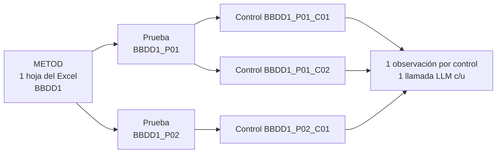
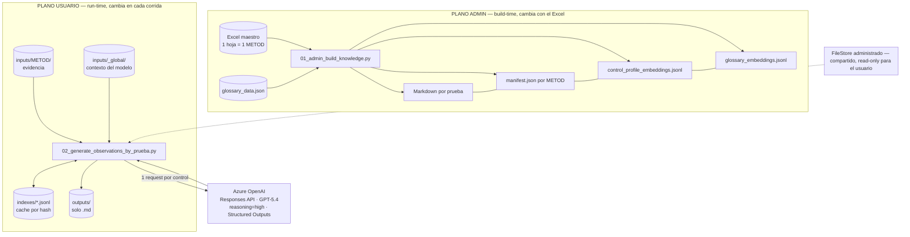
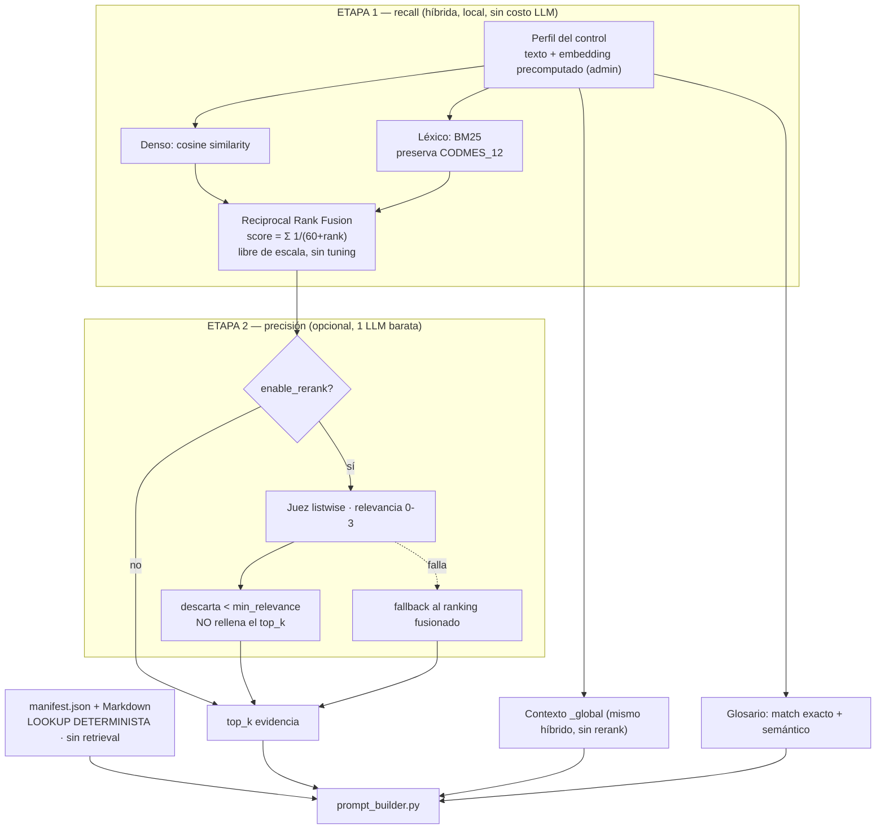
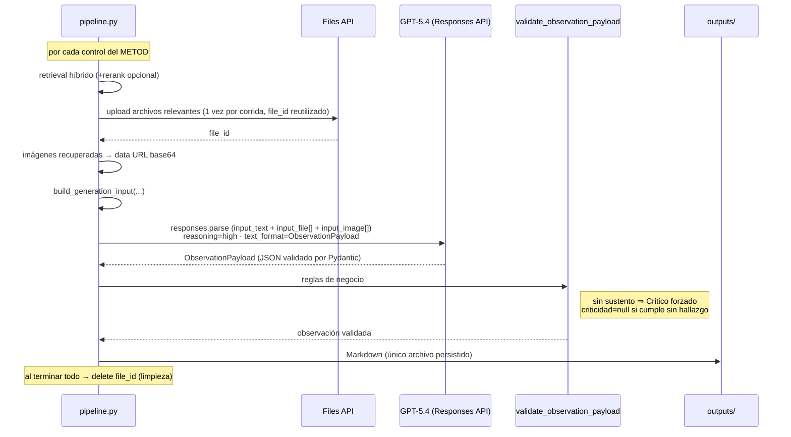

# Cuaderno de Traspaso — Gestor de Observaciones

> **Para quien reciba el proyecto sin contexto previo.**
> Este documento responde todo de una sola vez: qué hace la herramienta, qué requerimientos la originaron, cómo evolucionó, cómo se ejecuta y qué reglas no se deben romper.
>
> - **Fuente de verdad:** el código en [`metod_observations/`](metod_observations/). Si un documento difiere del código, gana el código.
> - **Orden de lectura recomendado:** este archivo → [`ARCHITECTURE.md`](ARCHITECTURE.md) (defensa técnica) → [`pipeline.py`](metod_observations/pipeline.py) → el resto del paquete.
> - Documentos relacionados: [`ARCHITECTURE.md`](ARCHITECTURE.md), [`PROJECT_HANDOFF.md`](PROJECT_HANDOFF.md), [`project_doc.md`](project_doc.md) (spec original, ya desactualizado).

---

## Índice

1. [Qué es y para quién — el objetivo](#1-qué-es-y-para-quién--el-objetivo)
2. [Los requerimientos que pidieron](#2-los-requerimientos-que-pidieron)
3. [Vocabulario: METOD, prueba, control](#3-vocabulario-metod-prueba-control)
4. [Cómo evolucionó desde el spec original](#4-cómo-evolucionó-desde-el-spec-original)
5. [Arquitectura: los dos planos](#5-arquitectura-los-dos-planos)
6. [El núcleo: retrieval por control](#6-el-núcleo-retrieval-por-control)
7. [Generación: una prueba, un request](#7-generación-un-control-un-request)
8. [Estructura de carpetas](#8-estructura-de-carpetas)
9. [Flujo del admin (build)](#9-flujo-del-admin-build)
10. [Flujo del usuario (run)](#10-flujo-del-usuario-run)
11. [Anatomía de una observación](#11-anatomía-de-una-observación)
12. [Mapa de módulos](#12-mapa-de-módulos)
13. [Levantar el proyecto de cero](#13-levantar-el-proyecto-de-cero)
14. [Reglas de oro: qué NO cambiar](#14-reglas-de-oro-qué-no-cambiar)
15. [Pendientes y riesgos](#15-pendientes-y-riesgos)
16. [FAQ](#16-faq)

---

## 1. Qué es y para quién — el objetivo

La herramienta genera **observaciones de validación metodológica** para procesos de revisión de modelos (scoring tradicional / ML de riesgo). En vez de comportarse como un chatbot genérico, actúa como **un revisor que ya sabe qué controles mirar en cada metodología** y solo necesita la evidencia del caso concreto para emitir un veredicto trazable.

| | |
|---|---|
| **Entra** | Evidencia que el analista sube por METOD: `.pdf .xlsx .docx .csv .sas .sql .py .html` e imágenes, más contexto global del modelo. |
| **Se cruza con** | El conocimiento estable (controles, límites, criticidad, excepciones) definido por el equipo responsable en un **Excel maestro**. |
| **Sale** | **Una observación por control**, con criticidad, sustento y **cita explícita** del fragmento y archivo que la respalda. Auditable por un revisor humano. |

> [!IMPORTANT]
> El componente central **no es el LLM**, es el pipeline que arma el contexto: seleccionar el control → leer sus reglas → recuperar la evidencia relevante → generar una observación estructurada. **Si las reglas del Excel son vagas, las observaciones serán vagas.**

---

## 2. Los requerimientos que pidieron

El proyecto nació como un **MVP dentro de Databricks Notebooks** para validar la lógica RAG de punta a punta, **sin construir una aplicación web**. Estas restricciones vinieron explícitas en el encargo y siguen marcando el diseño.

### ✅ Lo que SÍ se pidió

- Correr en **Databricks Notebooks**, con widgets.
- Usar **Azure OpenAI** para embeddings y generación.
- RAG local simple: parsear archivos → chunks → embeddings → similitud → contexto → LLM.
- Separar **conocimiento** (qué debe saber) de **evidencia** (qué debe analizar).
- **Salida estructurada** (JSON) + Markdown legible.
- **Citar las fuentes** usadas y **no inventar**; decir cuándo falta evidencia.
- Conocimiento estable en FileStore; artefactos de runtime en Workspace Files.

### ❌ Lo que se prohibió explícitamente

- Nada de **Streamlit**, Databricks Apps ni FastAPI (el frontend es el notebook).
- Nada de **Delta tables** ni Spark salvo que sea imprescindible.
- Nada de **base vectorial externa** (Pinecone, Chroma, Databricks Vector Search…).
- Nada de **LangChain** pesado ni **agentes autónomos**.
- **No sobre-ingeniería:** funciones simples, JSON en disco.
- **No mandar todos los archivos a ciegas** al LLM.

> [!NOTE]
> Varias de estas prohibiciones siguen siendo decisiones de arquitectura defendibles (ver [`ARCHITECTURE.md`](ARCHITECTURE.md)). Antes de introducir un framework o una vector DB, entiende que fueron **vetos deliberados del encargo**, no omisiones por olvido.

---

## 3. Vocabulario: METOD, prueba, control

Casi todo el código gira alrededor de tres niveles. La **unidad de análisis es el control**: cada control recupera su propia evidencia y produce su propia observación, con una llamada al LLM.



| Término | Qué es | Ejemplo / origen |
|---|---|---|
| **METOD** | Una metodología / familia de controles (p. ej. poder discriminante, estabilidad PSI). | Una hoja del Excel. ID: `BBDD1` |
| **Prueba** | Agrupa controles afines. Es `Detalle_prueba` en el Excel. | `BBDD1_P01` |
| **Control** | La unidad real de análisis: una fila activa del Excel. Genera una observación. | `BBDD1_P01_C01` |
| **Evidencia** | Archivos que el usuario sube para el METOD. | `inputs/<METOD>/` |
| **Contexto global** | Contexto compartido del modelo (target, `CODMES`, variables). Ayuda a interpretar, no prueba nada por sí solo. | `inputs/_global/` |
| **Manifest** | Inventario normalizado de un METOD (IDs, controles, reglas). El runtime lo lee en vez del Excel. | `manifest.json` |
| **Perfil de control** | Embedding estable que sirve de **consulta** del retrieval. Se precomputa una vez. | Notebook admin |

> [!WARNING]
> Los IDs se generan **por orden de aparición** en el Excel. Reordenar filas cambia `P01`, `P02`, `C01`… — **no son independientes del orden.**

---

## 4. Cómo evolucionó desde el spec original

El spec inicial ([`project_doc.md`](project_doc.md)) describe un MVP más simple. El sistema real creció en varios puntos. **Si lees solo el spec viejo, vas a esperar cosas que ya cambiaron.**

| Aspecto | Spec original (`project_doc.md`) | Sistema actual |
|---|---|---|
| Conocimiento | Archivos sueltos `rules.md` por METOD | **Excel maestro** → `manifest.json` + Markdown |
| Unidad de salida | Una observación **por METOD** | Una observación **por control** (1 LLM c/u) |
| Modelo | `gpt-4o-mini`, Chat Completions | **GPT-5.4** vía **Responses API**, `reasoning=high` |
| Imágenes | Descripción textual con visión → chunk | Imágenes reales adjuntas en **base64** (multimodal directo) |
| Retrieval | `cosine similarity` a secas | **Híbrido**: denso + BM25 → RRF → rerank opcional |
| Consulta | Contexto del modelo vía widgets | **Perfil de control** precomputado como consulta estable |
| Salida | Inglés: `observation, risk, action_plan…` | Español, `Structured Outputs` con Pydantic |

---

## 5. Arquitectura: los dos planos

Dos planos separados por **responsabilidad** y por **frecuencia de cambio**. El **admin** construye conocimiento estable (cambia con el Excel); el **usuario** ejecuta contra su propia evidencia (cambia en cada corrida). El embedding de perfil de cada control se calcula una vez, en el plano admin, y sirve como consulta para todos los usuarios.



**Por qué importa la separación:** el plano usuario **nunca genera embeddings de consulta** — reutiliza el perfil precomputado por el admin. El runtime valida además que el deployment de embeddings que generó los índices admin coincida con el actual, y falla ruidosamente si no.

---

## 6. El núcleo: retrieval por control

La consulta **no es la pregunta de un usuario** — no hay usuario preguntando. Es el **perfil del control** (su nombre y sus controles), estable y precomputado. La etapa 1 abre la ventana con dos canales; la etapa 2 la cierra descartando lo irrelevante en vez de rellenar el cupo.



Cuatro decisiones defendibles:

1. **La consulta es el perfil del control**, no una pregunta — estable, curada por el admin y precomputada.
2. **Recall primero, precisión después.** La etapa 1 abre la ventana (candidatos por canal); la etapa 2 la cierra con criterio semántico.
3. **La degradación siempre cae en un estado válido:** sin BM25 → denso puro; sin rerank → ranking fusionado; rerank que falla → ranking fusionado. Ninguna ruta rompe la corrida.
4. **Las reglas entran sin pasar por ningún retriever** — se leen por ID del manifest.

> **¿Por qué híbrido y no solo embeddings?** La evidencia está llena de **identificadores exactos** (`CODMES`, `target_default`, nombres de variables y tablas). Los embeddings densos son débiles en matching exacto de tokens raros; **BM25** los captura. Por eso el tokenizador preserva `_`: `CODMES_12` es una unidad léxica, no dos.

---

## 7. Generación: un control, un request

El retrieval actúa como **router**: cuando un chunk se recupera, el archivo *completo* se adjunta vía Files API para que el modelo lo lea entero. **No es RAG en lugar de contexto largo; es RAG dirigiendo contexto largo.**



---

## 8. Estructura de carpetas

### Zona ADMIN · FileStore (compartida, read-only para el usuario)

```text
/dbfs/FileStore/gestor_obs/knowledge/
├── _shared/
│   └── glossary_data.json
├── _indexes/
│   ├── _shared/
│   │   └── glossary_embeddings.jsonl
│   └── BBDD1/
│       └── control_profile_embeddings.jsonl
└── BBDD1/
    ├── manifest.json
    └── pruebas/
        └── BBDD1_P01_<slug>.md
```

### Zona USUARIO · Workspace Files

```text
/Workspace/Users/<user>/gestor_observaciones/
├── 02_generate_observations_by_prueba.py
├── inputs/
│   ├── _global/     # contexto del modelo (opcional)
│   └── BBDD1/       # evidencia — lo llena el usuario
├── indexes/         # cache de embeddings por hash (lo crea la corrida)
│   └── BBDD1/
│       └── evidence_chunks_embeddings.jsonl
└── outputs/
    └── BBDD1_run_YYYYMMDD_HHMMSS.md
```

> [!NOTE]
> **Lo único persistido en disco es el Markdown.** El payload estructurado, el `usage_summary` y el `retrieval_debug` vuelven **en memoria** dentro del `result` de `run_observation_pipeline` — se inspeccionan en el notebook o se pierden al cerrar la sesión. `indexes/` es cache: solo se re-embebe la evidencia nueva o modificada.

---

## 9. Flujo del admin (build)

Entrada: [`01_admin_build_knowledge.py`](01_admin_build_knowledge.py). Se corre cuando cambia el Excel maestro.
**Widgets:** `excel_path`, `sheet_name` (vacío = todas), `rebuild_embeddings`, `knowledge_base_dir`.

1. **Cargar y validar el Excel** con `openpyxl`. Columnas obligatorias: `Detalle_prueba, Detalle, Prompt, Limites, Criticidad, Excepciones, flag_on_wf`.
2. **Forward-fill de la prueba:** cuando `Detalle_prueba` viene vacío, hereda el último valor no vacío.
3. **Filtrar por `flag_on_wf`:** `1` activa la fila; `0` o vacío la ignora por completo. Si todas las filas de una prueba están en `0`, la prueba entera desaparece. Cualquier otro valor corta la carga con error.
4. **Agrupar y generar IDs** por orden de aparición, contando solo filas activas.
5. **Escribir conocimiento:** un Markdown por prueba (subsección por control) y un `manifest.json` por METOD.
6. **Embeddings estables:** genera (o reutiliza por hash) el perfil de cada control y los del glosario.

> **Cache de embeddings:** compara `id` + hash del texto + nombre del deployment. `rebuild_embeddings=false` es el uso normal; reconstruir cuando cambia el deployment de embeddings.

---

## 10. Flujo del usuario (run)

Entrada: [`gestor_observaciones/02_generate_observations_by_prueba.py`](gestor_observaciones/02_generate_observations_by_prueba.py). El notebook distribuible.
**Widgets visibles:** `metod_id` y `user_base_dir`. El admin fija `BACKEND_PROJECT_DIR` una vez antes de repartirlo. **Una corrida cubre un solo METOD.**

1. **Verificaciones previas:** que exista el manifest y los índices admin, y que el **deployment de embeddings coincida** con el que generó esos índices — si no, corta ruidosamente.
2. **Parsear evidencia:** descubre recursivamente `inputs/<METOD>/` e `inputs/_global/`. Sin evidencia del METOD, la corrida se detiene antes de gastar tokens.
3. **Chunk + embeddings (con cache):** trocea a ~1800 chars con overlap y reutiliza vectores por hash.
4. **Retrieval por control:** usa el perfil precomputado como consulta. Recupera evidencia (híbrido + rerank opcional), contexto global y glosario. Las reglas del control se leen del manifest, *sin* retrieval.
5. **Adjuntar archivos e imágenes:** sube a Files API los archivos cuyos chunks se recuperaron (hasta `MAX_PROMPT_FILES`, tope 50 MB) e incrusta imágenes recuperadas en base64.
6. **Una llamada LLM por control:** `responses.parse` con `text_format=ObservationPayload`.
7. **Validar y guardar:** reglas de negocio sobre la salida, Markdown a `outputs/`, y el resto en `result` en memoria.

---

## 11. Anatomía de una observación

Cada control produce un `ObservationPayload`. Hay **doble validación**: Pydantic garantiza la *forma*; `validate_observation_payload()` aplica las *reglas de negocio* que un schema no puede expresar.

```json
{
  "control_id": "BBDD1_P01_C01",
  "sustento_suficiente": true,
  "hay_observacion": true,
  "criticidad": "Moderado",
  "observacion": "...",
  "sustento": "...",
  "evidencias_usadas": [
    { "archivo": "evidencia.sql", "chunk_id": "BBDD1_E9e99d44c33b8_C001", "score": 0.82 }
  ],
  "informacion_faltante": []
}
```

**Reglas de negocio que el schema no sabe:**

- Sin sustento suficiente (`sustento_suficiente=false`) ⇒ `hay_observacion=true` y **`criticidad=Critico`** forzados (falta de evidencia = incumplimiento).
- `criticidad=null` solo cuando el control se cumple sin hallazgo (`hay_observacion=false`).
- Los `control_id` deben pertenecer a la prueba.
- Prueba y detalle del control se inyectan desde el manifest — no los inventa el modelo.

**Criticidad — únicos valores válidos:**

| Valor | Cuándo |
|---|---|
| `Critico` | Hallazgo grave — o **falta de evidencia** suficiente para el control. |
| `Relevante` | Hallazgo importante que exige acción. |
| `Moderado` | Hallazgo intermedio. |
| `Baja` | Hallazgo menor. |
| `Potencial` | Posible hallazgo a confirmar. |
| `null` | El control se cumple y hay evidencia suficiente. |

> [!WARNING]
> **La regla que más sorprende:** si no hay sustento, el sistema es **conservador a propósito** y reporta `Critico` en vez de "sin hallazgo". No presentar evidencia equivale a incumplimiento, no a ausencia de problema.

---

## 12. Mapa de módulos

Sin POO pesada: `dataclass` para contratos de datos, una sola clase ligera (`ModelClient`) y funciones pequeñas. Empezar cualquier cambio por aquí y por los dos notebooks numerados.

| Archivo | Responsabilidad |
|---|---|
| [`pipeline.py`](metod_observations/pipeline.py) | Orquesta todo — admin y usuario. **Empieza a leer aquí.** |
| [`config.py`](metod_observations/config.py) | Configuración, `.env`, `truststore` y resolución de rutas. |
| [`schemas.py`](metod_observations/schemas.py) | Dataclasses y modelos Pydantic (`ObservationPayload`). |
| [`excel_loader.py`](metod_observations/excel_loader.py) | Lectura, validación y normalización del Excel maestro. |
| [`knowledge_builder.py`](metod_observations/knowledge_builder.py) | Markdown, manifest y texto de perfil de cada control. |
| [`parsers.py`](metod_observations/parsers.py) | Extracción de texto por formato + registro de imágenes. |
| [`chunking.py`](metod_observations/chunking.py) | Troceo por caracteres con overlap y metadata. |
| [`embeddings.py`](metod_observations/embeddings.py) | `ModelClient` (Azure), Responses API y cache de embeddings. |
| [`retrieval.py`](metod_observations/retrieval.py) | Denso, BM25 y fusión RRF; top-k local. |
| [`reranking.py`](metod_observations/reranking.py) | Reranker listwise opcional (0–3, descarta bajo umbral). |
| [`prompt_builder.py`](metod_observations/prompt_builder.py) | Arma el input consolidado por control. |
| [`observation_generator.py`](metod_observations/observation_generator.py) | Parseo y validación defensiva de la respuesta. |
| [`outputs.py`](metod_observations/outputs.py) | Escritura de Markdown y armado del `result`. |

> [!NOTE]
> **No confundir con el núcleo.** Material histórico/experimental: `chunking_experiment/`, `knowledge/METOD5/*`, `project_doc.md` (spec viejo) y notebooks exploratorios. El runtime real es `metod_observations/` + los notebooks 01 y 02.

---

## 13. Levantar el proyecto de cero

1. **Clonar y crear el `.env`** desde [`.env.example`](.env.example). Nunca commitear secretos.
2. **Conseguir el Excel maestro** (no está versionado; se transfiere aparte). Es la fuente de todo el conocimiento.
3. **Subir el backend admin** — `metod_observations/`, `.env` y `01_admin_build_knowledge.py` — a una carpeta administrativa en Databricks.
4. **Correr el notebook 01.** Genera Markdown, manifest e índices en FileStore. Revisar que se hayan creado bien.
5. **Preparar la carpeta del usuario** con el notebook 02 y configurar `BACKEND_PROJECT_DIR` apuntando a la carpeta admin.
6. **Cargar evidencia y correr el 02:** archivos en `inputs/<METOD>/` (y opcional `_global/`), elegir `metod_id`, ejecutar.
7. **Revisar resultados:** el Markdown en `outputs/`, y en el notebook `result["retrieval_debug"]` y `result["usage_summary"]`.

### `.env` — configuración esperada

```env
AZURE_OPENAI_API_KEY=<secreto>
AZURE_OPENAI_ENDPOINT=https://<recurso>.openai.azure.com/

AZURE_OPENAI_CHAT_DEPLOYMENT=OAIXXX05        # → GPT-5.4
AZURE_OPENAI_EMBEDDING_DEPLOYMENT=OAIXXX04   # → text-embedding-3-small

RAG_KNOWLEDGE_BASE_DIR=/dbfs/FileStore/gestor_obs/knowledge

RAG_REASONING_EFFORT=high
RAG_TOP_K_EVIDENCE=8
RAG_TOP_K_GLOBAL_CONTEXT=4
RAG_TOP_K_GLOSSARY=5
RAG_MAX_PROMPT_FILES=4
RAG_MAX_PROMPT_IMAGES=2
RAG_CHUNK_SIZE=1800
RAG_CHUNK_OVERLAP=200
```

| Variable | Efecto |
|---|---|
| `RAG_REASONING_EFFORT` | Más razonamiento mejora análisis pero sube latencia y costo. Actual: `high`. |
| `RAG_TOP_K_EVIDENCE` | Máx. chunks de evidencia por control. Más alto = más contexto, más costo, más ruido. |
| `RAG_TOP_K_GLOBAL_CONTEXT` | Chunks globales por control. |
| `RAG_TOP_K_GLOSSARY` | Máx. términos de glosario recuperados. |
| `RAG_MAX_PROMPT_FILES` | Máx. archivos adjuntados como `input_file` por control. |
| `RAG_MAX_PROMPT_IMAGES` | Máx. imágenes reales adjuntadas por control. |
| `RAG_CHUNK_SIZE` / `RAG_CHUNK_OVERLAP` | Tamaño y solapamiento de chunks (caracteres). |

> En entorno corporativo, `truststore.inject_into_ssl()` es necesario para que el cliente use el almacén de certificados del sistema.

---

## 14. Reglas de oro: qué NO cambiar

Estas decisiones ya se discutieron. Cambiarlas sin una indicación explícita rompe supuestos del sistema o contradice el encargo.

- **No reintroducir frameworks:** nada de LangChain, vector DB externa, Delta ni agentes autónomos.
- **Una llamada LLM por control** — no agrupar por prueba ni por METOD.
- **Las reglas no van por RAG:** detalle, límites, criticidad y excepciones se leen por ID del manifest.
- **Notebook de usuario simple:** solo `metod_id` y `user_base_dir`; la config técnica queda del lado del admin.
- **Conservar la trazabilidad:** cada observación cita evidencia real recuperada; mantener `retrieval_debug`.
- **Enviar imágenes reales** al prompt cuando se recuperan, respetando el límite.
- **No crear tests** salvo que el usuario cambie explícitamente esa instrucción. La validación siguiente es un smoke run controlado en Databricks.
- Antes de editar, revisar `git status`; no revertir cambios ajenos.
- Al reportar avances, diferenciar entre **implementado**, **validado** y **pendiente**.

---

## 15. Pendientes y riesgos

El sistema está **implementado pero no validado end-to-end en un cluster real**. Ese es el primer trabajo de quien reciba el proyecto.

| Prioridad | Pendiente |
|---|---|
| 🔴 Alta | Smoke run real en Databricks: notebook admin con el Excel real, luego un METOD end-to-end con evidencia conocida. |
| 🔴 Alta | Confirmar que el deployment GPT-5.4 acepta Responses API, `reasoning=high`, `input_file`, imágenes y el modelo Pydantic. |
| 🔴 Alta | Validar programáticamente que `evidencias_usadas` solo cite chunks realmente enviados (hoy el schema valida forma, no procedencia). |
| 🔴 Alta | Validar la criticidad que viene del Excel: el enum se aplica a la salida del modelo, pero el loader no rechaza valores admin fuera del enum. |
| 🟠 Media | Definir un score mínimo de retrieval (hoy siempre se toma el top-k aunque la similitud sea baja). |
| 🟠 Media | OCR para PDFs escaneados y mejor recuperación de imágenes (captions / índice multimodal). |
| 🟠 Media | Reintentos ante rate limits de Azure y registro de tokens/uso real para estimar costo. |
| ⚪ Ojo | El `run_id` usa precisión de segundos: dos corridas simultáneas del mismo METOD podrían colisionar. Reordenar el Excel cambia los IDs. |

### Definición de terminado (MVP productivo)

Operativo cuando: el admin procesa el Excel real sin errores · FileStore tiene conocimiento e índices consistentes · el pipeline procesa todos los controles de un METOD · GPT-5.4 devuelve salida válida · las observaciones citan solo evidencia real · los casos sin evidencia no inventan hallazgos · los archivos e imágenes relevantes llegan al request · el debug permite auditar retrieval y archivos · costo y latencia son aceptables.

---

## 16. FAQ

**¿Por qué RAG y no meter todo en el prompt?**
Costo. Con `P` controles y `T` tokens de corpus, el *stuffing* factura `P × T`; RAG acota el contexto a top-k por control y embebe el corpus **una sola vez** (cacheado por hash). Además, meter todo choca con el tope de 50 MB por request. Detalle completo en [`ARCHITECTURE.md`](ARCHITECTURE.md).

**¿Por qué no una base vectorial (Pinecone, Chroma…)?**
El corpus por METOD es la evidencia de *un* usuario: cientos de chunks, no millones. La búsqueda en Python sobre JSONL toma milisegundos y la latencia real la domina el LLM. Una vector DB sería complejidad sin retorno para este volumen. Fue, además, un veto del encargo.

**¿Por qué una llamada por control y no una por prueba?**
Decisión funcional: cada control se evalúa por separado y recupera su propia evidencia, para que la observación sea específica y trazable a nivel de control.

**¿Qué modelo usa exactamente?**
El código usa el deployment configurado en `AZURE_OPENAI_CHAT_DEPLOYMENT`. En los documentos de diseño ese deployment apunta a **GPT-5.4** (`reasoning=high`, `max_output_tokens=25000`). Verifica el valor real en el `.env` del entorno.

**El texto de `parse_image_file()` dice que la visión "sería una etapa posterior". ¿Está sin implementar?**
No — la etapa multimodal **ya está implementada** (imágenes reales en base64). Ese comentario quedó desactualizado; es un detalle a limpiar.

**¿Dónde veo por qué el sistema dijo algo?**
En `result["retrieval_debug"]`: por control y por chunk registra `score`, `retrieval_mode`, `found_by`, `rerank_relevance`, si se envió como archivo o imagen. Permite separar un fallo de *retrieval* de uno de *generación*.
